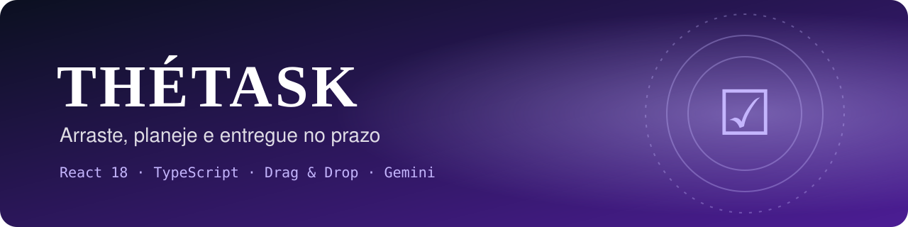
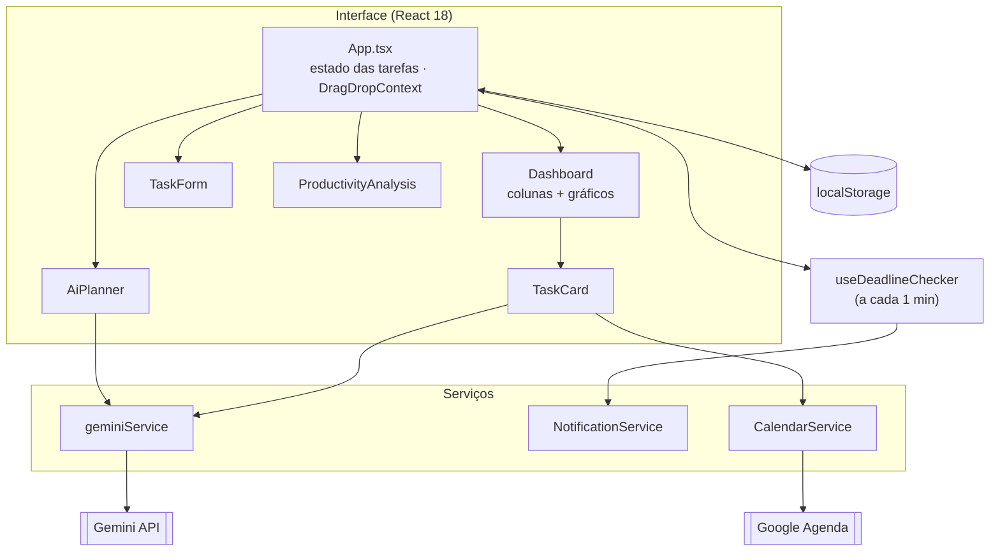
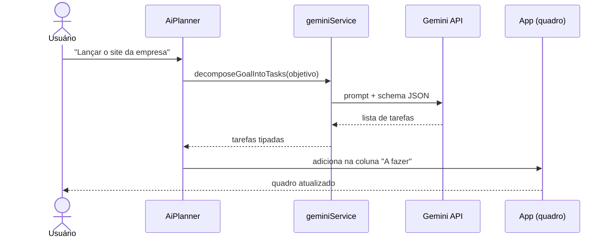

<div align="center">



# ☑ ThéTask
### Arraste, planeje e entregue no prazo

**Quadro de tarefas (Kanban) em React e TypeScript, com planejamento assistido por IA.**
Arraste tarefas entre colunas, defina prioridade e prazo, receba avisos antes do vencimento,<br/>
envie para o Google Agenda e deixe o Gemini quebrar um objetivo grande em tarefas concretas.


</div>

---

## 👨‍💻 Autor

<table>
  <tr>
    <td width="62%">

Eu sou o **Gustavo Osterno Thé**, e o **ThéTask** é um dos projetos do meu portfólio público. Idealizei, desenvolvi e mantenho este repositório.

Gerenciadores de tarefa costumam falhar em dois pontos: **começar** (um objetivo grande paralisa) e **não esquecer** (o prazo passa sem ninguém perceber). No ThéTask, ataquei os dois: a IA transforma um objetivo em tarefas acionáveis e o próprio navegador avisa quando um prazo está chegando. A versão com API, banco e autenticação desse mesmo domínio é a [Moirai](https://github.com/GustavoThe01/moirai-taskflow).

    </td>
    <td width="38%">

| | |
|---|---|
| 🌐 Site | [site-gustavothe-dev.web.app](https://site-gustavothe-dev.web.app/) |
| 💼 LinkedIn | [gustavoosterno](https://www.linkedin.com/in/gustavoosterno/) |
| 🐙 GitHub | [@GustavoThe01](https://github.com/GustavoThe01) |
| 📸 Instagram | [@gustavo.osterno](https://www.instagram.com/gustavo.osterno) |

    </td>
  </tr>
</table>

---

## 📑 Sumário

- [Em números](#-em-números)
- [A origem do nome](#-a-origem-do-nome)
- [O que o sistema faz](#-o-que-o-sistema-faz)
- [Colunas e prioridades](#-colunas-e-prioridades)
- [Arquitetura](#️-arquitetura)
- [Como um objetivo vira tarefas](#-como-um-objetivo-vira-tarefas)
- [Competências demonstradas](#-competências-demonstradas)
- [Metodologias e decisões](#-metodologias-e-decisões)
- [Roadmap](#️-roadmap)
- [Como rodar](#-como-rodar)
- [Testes](#-testes)
- [Estrutura do projeto](#-estrutura-do-projeto)
- [O que ainda falta](#-o-que-ainda-falta)
- [Projetos relacionados](#-projetos-relacionados)

---

## 📊 Em números

<div align="center">

| 📋 Quadro | 🧠 IA | 🔔 Prazos | 🗓️ Processo |
|:---:|:---:|:---:|:---:|
| **4** colunas de status | objetivo → **lista de tarefas** | aviso **30 min** antes do prazo | **7** commits · fev/2026 |
| **4** níveis de prioridade | dica de otimização por tarefa | verificação a cada **1 min** | protótipo no Google AI Studio |
| drag & drop entre colunas | respostas em **JSON** estruturado | link para o **Google Agenda** | versão **beta** concluída |

<sub>Números do estado atual do repositório. O que vem a seguir está em <a href="#-o-que-ainda-falta">O que ainda falta</a>.</sub>

</div>

---

## ☑ A origem do nome

> *Uma tarefa só termina quando alguém marca o ☑.*

**Thé** vem do meu sobrenome e **Task** é tarefa. O nome deixa claro que é o meu jeito de organizar trabalho: um quadro simples, rápido de usar e com ajuda inteligente só onde ela realmente economiza tempo.

---

## ✨ O que o sistema faz

| Recurso | O que resolve |
|---|---|
| 🗂️ **Quadro Kanban** | Tarefas em colunas de status, movidas com **arrastar e soltar** |
| 🏷️ **Detalhes da tarefa** | Título, descrição, prioridade, tags e prazo |
| 🤖 **Planejador com IA** | O Gemini quebra um objetivo em uma lista de tarefas técnicas |
| 💡 **Dica de otimização** | Sugestão curta da IA para executar cada tarefa melhor |
| 🔔 **Avisos de prazo** | Notificação do navegador quando faltam menos de 30 minutos |
| 📅 **Google Agenda** | Gera o link para adicionar a tarefa na agenda |
| 📊 **Produtividade** | Gráficos de status e prioridade (Recharts) |
| 💾 **Persistência** | Tarefas salvas no `localStorage`, sem cadastro |

---

## 🌐 Colunas e prioridades

| Status | | Prioridade |
|---|---|---|
| A fazer | | Baixa |
| Em progresso | | Média |
| Concluído | | Alta |
| Bloqueado | | Crítica |

---

## 🏛️ Arquitetura

O `App` concentra o estado das tarefas e o salva no navegador. Recursos externos (IA, notificações, agenda) ficam em serviços pequenos e isolados.



---

## 🔄 Como um objetivo vira tarefas



---

## 🧠 Competências demonstradas

| Área | Conceitos |
|---|---|
| **React** | Estado de lista com imutabilidade, custom hook (`useDeadlineChecker`), componentização |
| **Interação** | Drag & drop acessível com `@hello-pangea/dnd` |
| **APIs do navegador** | Notification API, `localStorage`, timers com limpeza |
| **Integrações** | Gemini (saída estruturada), link de evento do Google Agenda |
| **TypeScript** | Enums de status e prioridade, interface `Task` |
| **Visualização** | Gráficos de pizza e barras com Recharts |

---

## 🧭 Metodologias e decisões

- **Serviços como classes estáticas** (`NotificationService`, `CalendarService`): fáceis de testar e de trocar.
- **IA só onde economiza tempo**: planejar e sugerir, nunca decidir pelo usuário.
- **Sem conta, sem servidor**: as tarefas ficam no navegador de quem usa.
- **Protótipo no Google AI Studio**: por isso o `metadata.json` e as dependências via *import map*.

---

## 🗺️ Roadmap

| Fase | Tema | Versão | Progresso |
|---|---|:---:|---|
| 1 | Kanban, prioridades, prazos, agenda, IA e gráficos | `beta` | 🟩🟩🟩🟩🟩 |
| 2 | Testes, CI e atualização para React 19 | `v1.0.0` | ⬜⬜⬜⬜⬜ |
| 3 | Sincronização com uma API (como a Moirai) e login | `v2.0.0` | ⬜⬜⬜⬜⬜ |

---

## 🚀 Como rodar

**Pré-requisito:** [Node.js 20+](https://nodejs.org/).

```bash
git clone https://github.com/GustavoThe01/taskboard-react-ts.git
```

```bash
cd taskboard-react-ts
```

```bash
npm install
```

Crie um arquivo `.env.local` na raiz com a sua chave do [Google AI Studio](https://aistudio.google.com/apikey) (só é necessária para os recursos de IA; o quadro funciona sem ela):

```bash
GEMINI_API_KEY=sua_chave_aqui
```

```bash
npm run dev
```

Acesse `http://localhost:3000` e permita as notificações do navegador para receber os avisos de prazo.

> ⚠️ O Vite injeta a `GEMINI_API_KEY` no código do navegador. Use este projeto **apenas localmente**; para publicar, as chamadas à IA precisam passar por um backend.

---

## 🧪 Testes

Ainda não há testes automatizados neste repositório. O plano:

| Tipo | Ferramenta | Situação |
|---|---|---|
| Unitários (`useDeadlineChecker`, `CalendarService`) | Vitest | ⏳ Planejado |
| Componentes (formulário e quadro) | Testing Library | ⏳ Planejado |
| Arrastar e soltar de ponta a ponta | Playwright | ⏳ Planejado |

---

## 📁 Estrutura do projeto

```
taskboard-react-ts/
├── components/
│   ├── Dashboard.tsx            # ✅ colunas e gráficos
│   ├── TaskCard.tsx             # ✅ cartão + dica da IA + agenda
│   ├── TaskForm.tsx             # ✅ criar e editar tarefas
│   ├── AiPlanner.tsx            # ✅ objetivo → tarefas com IA
│   ├── ProductivityAnalysis.tsx # ✅ análise de produtividade
│   └── Button.tsx
├── hooks/
│   └── useDeadlineChecker.ts    # ✅ verifica prazos a cada minuto
├── services/
│   ├── geminiService.ts         # ✅ IA
│   ├── NotificationService.ts   # ✅ notificações do navegador
│   └── CalendarService.ts       # ✅ link do Google Agenda
├── docs/assets/                 # ✅ banner
├── App.tsx                      # ✅ estado, drag & drop e persistência
├── types.ts                     # ✅ Task, Status, Priority
├── index.html
└── vite.config.ts
```

---

## 🧩 O que ainda falta

Mantenho aqui um checklist vivo do que ainda vou incrementar neste repositório.

**Projeto**
- [x] Kanban com drag & drop, prioridades e prazos
- [x] Planejador e dicas com IA
- [x] Avisos de prazo e link para o Google Agenda
- [ ] Testes com Vitest e GitHub Actions
- [ ] Atualizar para React 19
- [ ] Mover as chamadas ao Gemini para um backend
- [ ] Sincronizar tarefas entre dispositivos (API + login)

**README**
- [ ] GIF do drag & drop e do planejador com IA
- [ ] Link de uma demonstração publicada
- [ ] Definir e adicionar uma licença (`LICENSE`)

---

## 🔗 Projetos relacionados

| Projeto | Stack | Relação |
|---|---|---|
| ♾ [Moirai](https://github.com/GustavoThe01/moirai-taskflow) | Spring Boot | **O mesmo domínio no back-end**: API Kanban com segurança e testes |
| ◆ [CorePlan](https://github.com/GustavoThe01/coreplan-api) | Spring Boot | API REST de tarefas e equipes |
| ❖ [JCore](https://github.com/GustavoThe01/jcore-task-manager) | Java | Gerenciador de tarefas em linha de comando |
| ◈ [FlowDash360](https://github.com/GustavoThe01/flowdash360-beta) | React + Gemini | Outro painel com IA integrada |
| ☑ **ThéTask** | React 18 | *você está aqui* |

<div align="center">

<sub>Quadro organizado por mim, tarefa por tarefa · <a href="https://github.com/GustavoThe01">Gustavo Osterno Thé</a></sub>

</div>
